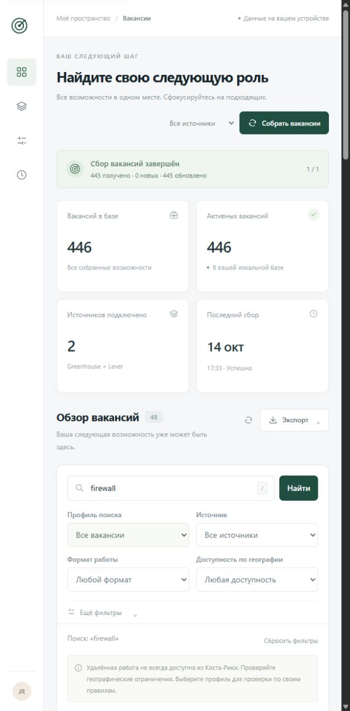
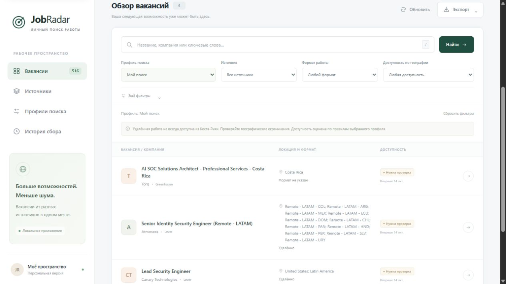

# Проверка MVP — 14 октября 2026 года

Окружение: Windows, Python 3.12.10, зависимости из `requirements-lock.txt`.

| Проверка | Результат |
| --- | --- |
| `python -m pytest -q --cov=jobradar --cov-report=term` | 196 passed, 3 skipped; покрытие 95% |
| `JOBRADAR_INTEGRATION=1 python -m pytest -m integration -q` | 3 passed: cloudflare, lever, leverdemo |
| `python -m ruff check .` | Все проверки прошли |
| `python -m ruff format --check .` | 28 файлов отформатированы |
| `python -m pip check` | Несовместимых зависимостей нет |
| Первый реальный `collect` | Greenhouse/Cloudflare: 446 получено, 446 добавлено; Lever: корректная пустая выдача |
| Повторный реальный `collect` | 446 обновлено, 0 добавлено, ошибок нет |
| Проверка SQLite и CSV/JSON | По 446 записей; 0 пустых описаний; суммарно 4 438 278 символов описаний |
| Поиск `firewall` | 48 совпадений |
| Профиль Network Security | 73 совпадения, все `needs_review` по географии |

Офлайн-тесты используют MockTransport/фикстуры и временные базы; интернет не требуется.
Три реальных интеграционных теста пропускаются без явного opt-in. Пустой board
допустим: количество текущих вакансий не является постоянным контрактом API.
`leverdemo` — официальный демонстрационный board, его вакансии не добавлялись в рабочую базу.

Рабочая БД после проверки — `data/jobradar.db`; примеры фактического экспорта —
`exports/jobs.csv` и `exports/jobs.json`. Эти каталоги исключены из Git.

Проверены Greenhouse и Lever global через интернет; EU endpoint покрыт мокированными
тестами. Linux/macOS, реальный PostgreSQL и установленные задачи cron/Task Scheduler
в этой среде не проверялись. Расписание описано в README и автоматически не создавалось.

## Локальное веб-управление

После добавления FastAPI-панели:

- Полный набор: **269 passed, 3 skipped**, покрытие **95%**. Три интеграционных
  теста по-прежнему требуют opt-in. Есть одно предупреждение Starlette о будущем
  переходе тестового клиента с httpx на httpx2; ошибок нет.
- Ruff, форматирование, `node --check jobradar/web/static/app.js` и `pip check` проходят.
- Wheel собран успешно; проверено включение HTML, CSS, JS и SVG в пакет.
- Реальный браузер: начальная загрузка 446 записей, поиск `firewall` — 48 результатов,
  выбор профиля, открытие полного описания и исходной ссылки, сохранение источников
  и профилей, переходы между разделами, фоновый сбор и история.
- Запуск Greenhouse из браузера завершился успешно: 445 получено, 445 обновлено,
  0 новых. В SQLite осталось 446 записей: отключённая деактивация не снимает одну
  исчезнувшую из текущей выдачи вакансию.
- JSON скачан браузером в `Downloads/jobradar-2026-10-14.json`; проверено наличие
  всех 48 результатов поиска. Пагинация показывает 25 из 48 и не ограничивает экспорт.
- Личные `config/sources.yaml` и `config/profiles.yaml` созданы сохранением через
  панель; исходные examples не изменены. CLI использует личные файлы по умолчанию.
- Браузер не сообщил ошибок JavaScript после итоговой перезагрузки.

Запуск для пользователя: двойной щелчок по `Start-JobRadar.cmd` либо
`python -m jobradar serve --open` из установленного окружения. Сервер слушает только
`127.0.0.1:8765`; тестовый сервер после проверки останавливается.

## Исправления Lever и релевантности

- Выяснено, что `identifier: lever` возвращал HTTP 200 и пустой список: это board
  самой компании Lever, а не глобальный поиск по платформе. Он выключен.
- Проверены и включены реальные Lever boards: Canary Technologies (31 запись),
  Atmosera (14). Повторный сбор обновил 45 записей, не добавив дублей.
- Добавлен Greenhouse/Torq: 25 записей, включая SOC Solutions Architect — Costa Rica.
- Появились `exclude_title_keywords`, обязательные роли в `title_keywords`, профиль
  **Security Operations** и общий **Мой поиск**, выбранный через `default_profile`.
  Упоминания firewall/Palo Alto/SOC 2 в тексте продаж или software-роли не достаточны.
- Гибридные/офисные роли дополнительно проверяют опубликованные офисы и Job Posting
  Location. Иностранные офисы больше не скрываются за общим значением `Hybrid`.
  Для remote физический офис сам по себе не превращается в ограничение найма.
- Исходное поле location остаётся неизменным; дополнительные локации отображаются
  в веб-карточке, доступны поиску и участвуют в инвалидировании кеша.
- В текущей базе 516 записей, в основной подборке 4 кандидата. У всех остаются
  условия для ручной проверки; совпадение роли не гарантирует доступность из Costa Rica.
- Сохранены исходные пользовательские настройки в `data/config-backups/20261014T234932Z`.
- Итоговый офлайн-прогон: **290 passed, 6 skipped**, покрытие **94%**; Ruff и JS syntax
  проходят. Реальные интеграционные проверки запускаются отдельно с opt-in.
- В браузере проверены стартовый профиль, реальные записи Lever и объяснение пустого
  board. Для применения обновления запущенный пользовательский сервер нужно перезапустить.

## Подготовка к публикации — 14 октября 2026 года

- Стартовый профиль сужен до Network/Firewall/NDR/SOC и эксплуатации ИБ.
  IAM, Product/Application Security, исследования и общие названия без специализации
  исключены из основной подборки. На сохранённом снимке осталось 2 кандидата,
  оба требуют проверки условий; 516 записей остаются в полном инвентаре.
- Итоговые локальные тесты: **324 passed, 6 skipped**, покрытие **94%**.
  Шесть проверок реальных API пропущены без opt-in. Сохраняется одно предупреждение
  стороннего Starlette TestClient, описанное выше.
- Из чистой копии 63 файлов Git-индекса без личных настроек и БД тот же набор
  завершился с **324 passed, 6 skipped**. Локальные Markdown-ссылки и структура
  workflow также проверены; CLI `--help` запускается.
- Ruff check, Ruff format (44 файла), `pip check` и проверка JS-синтаксиса проходят.
- Собран wheel `jobradar-0.1.0-py3-none-any.whl`; все четыре веб-ресурса включены.
- В подготовленном индексе 63 файла. База, экспорты, личные YAML, `.env`, кеши,
  окружение и резервные копии исключены. Проверка известных форматов токенов,
  приватных ключей, URL с паролями и персональных Windows-путей совпадений не дала.
- Добавлены CI для Windows/Linux и Python 3.12/3.13, правила переносов строк,
  инструкция разработки и публикации. Удалённый CI до первого push не выполнялся;
  локально проверена Windows с Python 3.12.10.
